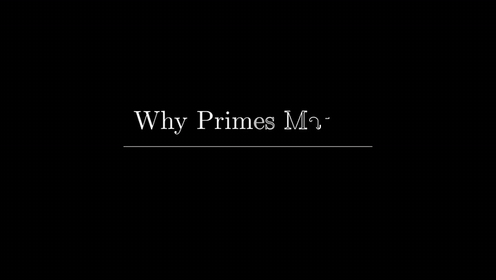

# Manimatic

[](https://github.com/jackstanton6/manimatic/actions/workflows/ci.yml) [](LICENSE)

**Narration-driven maths videos in the style of 3Blue1Brown, made with Claude Code and [ManimGX](https://manimgx.academa.ai) (Manim's API, rendered on the GPU).**

Give Claude your script (with optional notes about what to show) and your voice recording. Manimatic:

1. **Transcribes** the recording with word timings (faster-whisper, or WhisperX on a GPU).
2. **Edits the audio.** It keeps the **last complete take** of every line (including pickups recorded later in the session) and cuts flubs, false starts, retake cues ("sorry, let me say that again"), slates, ums and long pauses. Ad-libs are **kept and flagged** for you to decide on.
3. **Checks its own edit.** It transcribes the edited voice again and compares it with your script, so a ghost syllable, a doubled word or a missing phrase is caught before you hear it.
4. **Writes `PLAN.md`**: timed scenes, the exact visuals for each, audio edits to tick or untick, annotations to confirm, and the exam questions it found in your references. You edit it, then approve it; the final render is locked until you do.
5. **Writes the Manim code**, with every animation anchored to the word it illustrates. It renders a fast preview, fixes anything the automatic checks flag, and then renders the final video.
6. **Delivers** a 1080p60 MP4 (up to 4K) with ducked background music, intro and outro stings over the title and end cards, SRT/VTT captions (optionally burned in), and YouTube chapters.

Your feedback ("at 2:13 the equation is too small", "keep that ad-lib") is applied to just the scenes involved.

<p align="center"></p>
<p align="center"><sub>The bundled demo, built end to end from <code>examples/demo</code> (captions burned in so you can follow without sound).</sub></p>

Works on Windows, macOS and Linux. English only in v1.

---

## Install

You need [Claude Code](https://claude.com/claude-code), Python 3.10+ and **ffmpeg**. No LaTeX: ManimGX typesets maths itself.

```text
/plugin marketplace add jackstanton6/manimatic
/plugin install manimatic@manimatic
```

<details><summary>Installing for one project only</summary>

From a terminal in the project's folder:

```bash
claude plugin marketplace add jackstanton6/manimatic --scope project
claude plugin install manimatic@manimatic --scope project    # shared with the repo via .claude/settings.json
claude plugin install manimatic@manimatic --scope local      # just you, just this folder (not committed)
```
</details>

Then ask Claude: *"set up Manimatic"* (or run `/manimatic:start`). It runs the doctor, which installs ManimGX, faster-whisper and friends into a private Python 3.13 environment (`~/.manimatic/venv`), and tells you exactly what's missing for your OS. If you have no Python 3.13, it suggests [uv](https://docs.astral.sh/uv/), which fetches it for you.

<details><summary>Installing ffmpeg</summary>

| | ffmpeg |
|---|---|
| Windows | `winget install Gyan.FFmpeg` (then open a new terminal) |
| macOS | `brew install ffmpeg` |
| Linux | `sudo apt install ffmpeg` |

Allow a few GB of free disk for renders and the Whisper model.
</details>

The doctor also decodes a real audio clip, to catch package combinations that install but don't work. `python3 mm.py doctor --deep` goes one step further and transcribes a sample with the tiny Whisper model.

Got an NVIDIA GPU? `python3 mm.py doctor --install --gpu cuda` makes transcription several times faster. Add `--whisperx` for even sharper word boundaries.

### Rendering on the GPU
Scenes render with [ManimGX](https://manimgx.academa.ai), which takes Manim CE's API and renders it on the GPU (Metal, DirectX 12 or Vulkan). The same scenes (the bundled demo and three Banach–Tarski-style test scenes, 1080p60) rendered with both engines (Manim CE with its LaTeX cache off, so its 2D times include typesetting):

| | ManimGX | Manim CE |
|---|---|---|
| Desktop, RTX 5070 Ti | 10.5 s | 445 s |
| MacBook Air M1 (two 3D scenes + one 2D) | 20.6 s | 240.7 s |

3D benefits most: a ball split into five lit pieces went from 254 s to 2.5 s on the desktop. Without a GPU (a headless server, CI), ManimGX draws on the CPU at roughly Manim CE's speed. `mm.py doctor` says which one you have.

If ManimGX can't run on your machine, the same scene files also render with Manim CE: `mm.py doctor --install --with-manim-ce`, install LaTeX, and set `[render] engine = "manim"`.

## Use

```text
/manimatic:start my-video      create the project, then drop files into its folders
/manimatic:plan                 transcribe, cut, find references, write PLAN.md for your review
/manimatic:build                write the scenes, render a preview, then the final video
/manimatic:revise               apply your notes
```

Or just talk to Claude: *"Here's my script and recording, make the video."*

### Project folder
```
my-video/
├── script/        your script: .docx .md .txt .pdf .tex (anything else via pandoc)
├── audio/         one recording or several (joined in natural order: take2 before take10)
├── music/         optional: bed.*, intro.* (over the title card), outro.* (over the end card)
├── references/    optional: exam papers, textbook pages, images
├── PLAN.md        the plan: you review and edit this
├── scenes/        generated Manim code (yours to tweak)
├── output/        video, captions, chapters, edited voice
└── manimatic.toml settings
```

### Writing the script
Write it the way you'll say it. Put directions in `[[double brackets]]`:

```markdown
# Why primes matter
[[title card: Why Primes Matter]]

Every whole number can be built from primes. [[equation: $60 = 2^2 \cdot 3 \cdot 5$ @ "built"]]

*Show a number line from 1 to 30 with the primes highlighted.*

Here's a question from last year's exam. [[ref: exam2023.pdf, question 4b]]
```

You don't have to use the brackets. Labels like `Visual:`, bracketed or italic paragraphs, Word comments and `%` comments in LaTeX are detected too. Every guess appears in PLAN.md for you to confirm. Headings become sections and YouTube chapters. See [reference/annotation-syntax.md](reference/annotation-syntax.md).

### Showing exam questions
Put the paper in `references/` and point at it: `[[ref: exam2023.pdf, question 4b]]`. Manimatic finds the question in the PDF and crops it (keeping the question stem for a sub-part). It then shows it either as the original, rendered light-on-dark to suit the background, or retyped in LaTeX so it can be animated line by line. You choose per reference in PLAN.md.

Scanned papers and photos work too: pages without a text layer are read with OCR (Tesseract if you have it, otherwise the built-in RapidOCR).

### Pauses for the visuals
The edit tightens long pauses, so mark the ones you want: `[[hold 2s]]`, `[[pause]]` (1.5 s) or `[[beat]]` (0.8 s). Manimatic puts exactly that much room-tone silence there, and the scene uses it for a visual with no narration over it.

### Camera moves and 3D
Scenes can zoom and pan across a large diagram, or go fully 3D with 3b1b-style checkerboard surfaces, camera moves and slow orbits. Titles and equations stay pinned flat to the screen.

### No recording yet?
`/manimatic:plan --draft` plans and previews with a text-to-speech voice. When you record, run it again: scenes are anchored to words, so everything re-times itself.

### Review and approval
`/manimatic:plan` ends with one review: every ad-lib quoted, anything the audio check flagged, the reference crops, and a line per section about the visuals. Then it asks you to **approve the plan**. Until you do, you can build previews (labelled "DRAFT · plan not approved"), but not the final render. Tick the box at the top of PLAN.md, or just tell Claude "approve".

### Music
Put up to three files in `music/`: `bed.*` plays quietly under everything and ducks under your voice; `intro.*` and `outro.*` are stings over the title and end cards. Without a sting, the bed plays under that card. The bed's loudness is measured and set relative to your voice (`[music] bed_level`, default 20 LU below it), and `bed_start` skips a quiet intro in the track. After mixing, Manimatic checks that the cards, holds and long pauses actually have sound.

## How the audio editing works
Every script sentence is located in the transcript with fuzzy local alignment, which finds *every* take. Walking backwards through the script, Manimatic picks the latest complete take that comes before the next line's chosen take. That keeps your last attempt and copes with repeated sentences. A later out-of-order take (a pickup) replaces an earlier one. Everything left over is classified:

| | Default |
|---|---|
| Earlier takes, false starts, retake cues, slates | cut |
| Stutters and cut-off words | cut |
| Ums and uhs, including ones Whisper didn't transcribe, detected as sound in pauses | cut |
| Pauses longer than 0.5 s | shortened to a natural length |
| Ad-libs (speech that isn't in the script) | **kept**, flagged in PLAN.md |

Joins get short fades and are filled with your room's own background noise, taken from the quietest gap *between* words, so it works with noise-gated recordings too. You can listen to the result (`output/voice_edit.wav`) before any visuals exist. Change any decision by ticking it in PLAN.md or running `mm.py cuts set C004 keep`.

## Checking the visuals without burning tokens
Before anything renders, the scene code is type-checked, so a misspelt keyword or method is caught in a second rather than after a render. Every scene is then audited while it renders: objects off screen, text overlapping text (letter by letter, not just bounding boxes), and animations that start after the word they belong to. Claude looks at frames only for scenes that were flagged. For risky scenes (3D, camera moves, dense layouts) it checks one **contact sheet** per scene: a single image with a labelled frame at every animation beat (`mm.py sheet S03.2`).

## Long videos
Built for videos up to about 2 hours:
- Transcription is cached per file.
- Scenes render in a few parallel processes and are cached, so a revision re-renders only what changed.
- Claude works one section at a time, rendering and checking each section as it's written, and starts the final render in the background as soon as the plan is approved.
- With more than about a dozen scenes, Claude writes the sections in parallel with subagents, all following a shared `scenes/common.py` (colours, recurring diagrams, objects carried between scenes) so the video still reads as one piece.
- All state lives in files (`mm.py status` tells a fresh session where things are).
- Each scene is cut to its exact frame count, so picture and sound can't drift.

## Under the hood
The skills call a cross-platform Python CLI (`mm.py`). You can use it without Claude too: see [reference/cli.md](reference/cli.md). The scene component library (cards, references, equations, emphasis, plots and a timed `ManimaticScene`) is documented in [reference/component-library.md](reference/component-library.md).

Try it on the bundled example: `examples/demo` is a 40-second project with a deliberately messy recording (a slate, a false start, an um, an ad-lib, a flubbed line with a retake cue, and an out-of-order pickup) and an exam-question reference.

## Contributing
Bug reports and pull requests are welcome; see [CONTRIBUTING.md](CONTRIBUTING.md). If a recording misbehaves, the most useful thing you can attach is its `.manimatic/asr/*.json` transcript cache (no audio needed).

## Licence
GPL-3.0-or-later. ManimGX's code is MIT-licensed (its native wheels, which include x264, are GPL-3.0-or-later as a whole); Manim CE is MIT-licensed. Manimatic is not affiliated with 3Blue1Brown, the Manim Community or Academa.
